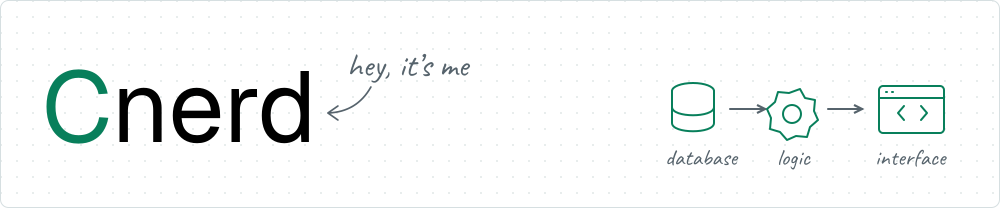

<picture>
  <source media="(prefers-color-scheme: dark)" srcset="assets/profile-header-dark.svg">
  <source media="(prefers-color-scheme: light)" srcset="assets/profile-header-light.svg">
  
</picture>

# Hey, I’m Mahadi

**Full Stack AI Engineer · Dhaka, Bangladesh**

I like building things and thinking through problems from first principles. These days, I’m mostly building SaaS products, commerce tools, and AI apps.

I use AI agents throughout planning, coding, and testing, and I also build AI-powered features into my projects.

[Portfolio ↗](https://cnerdfolio.vercel.app/) · [LinkedIn ↗](https://linkedin.com/in/cnerd-mahadi) · [Email ↗](mailto:mahadidroid@gmail.com)

##  What I’m working on

At **Bevy Commerce**, I’m a Full Stack Developer building Shopify tools—from database design to backend logic and user-facing interfaces. Some of that work:

- **Affiliate platform:** Built and owned the MVP, including merchant and affiliate dashboards, referral tracking, commission calculations, and payout records.
- **Subscription billing:** Built trials, coupons, paywalls, and per-shop overrides, with Redis caching and a fallback when the cache is unavailable.
- **Balances and payments:** Replaced full ledger scans with transaction-updated balances and reconciliation. Added locking and duplicate checks to QuickBooks payment processing in an existing app.
- **Background jobs:** Redesigned recommendation processing around per-shop jobs with safe reruns, retries, and failure isolation.
- **PDF generation:** Built and owned the complete Playwright system for invoices, orders, purchase orders, and quotes, with customizable brand and location templates.

Previously at **AISEO.ai**, I helped migrate interfaces to Next.js and built responsive React components from Figma designs.

##  Projects

### [LITOL](https://github.com/Cnerd-Mahadi/litol_app)

An AI learning app I built, used by **60+ students** to organize notes, review question-and-answer cards, generate editable summaries, and take quizzes with score history.

Quizzes are grounded in students’ own notes using Gemini, RAG, and pgvector similarity search.

`Next.js` `TypeScript` `PostgreSQL` `Prisma` `pgvector` `Gemini` `Vercel AI SDK`

[Live ↗](https://litol.vercel.app/) · [Source ↗](https://github.com/Cnerd-Mahadi/litol_app)

### [BeatRos](https://github.com/Cnerd-Mahadi/BeatRos)

A personal commerce project with product, cart, order, and inventory services behind an API gateway.

Guest carts merge into account carts on sign-in. Stripe checkout connects to stock reservations and stock release when payments fail. QStash runs background stock-release tasks and order-confirmation emails.

`Next.js` `Express` `TypeScript` `PostgreSQL` `Redis` `Stripe` `Docker`

[Live ↗](https://beatros.vercel.app/) · [Source ↗](https://github.com/Cnerd-Mahadi/BeatRos)

##  Tools I use

- **Web:** TypeScript, JavaScript, React, Next.js, Remix, Tailwind CSS
- **Backend & data:** Node.js, Express, Prisma, PostgreSQL, MongoDB, Redis
- **AI & background jobs:** Gemini, Vercel AI SDK, RAG, pgvector, BullMQ, QStash
- **Integrations & delivery:** Shopify, QuickBooks, Stripe, Typesense, Docker, GitHub Actions

##  Let’s connect

I’m open to remote engineering roles working on SaaS products, commerce tools, or AI apps.

[Drop me a line](mailto:mahadidroid@gmail.com) or [connect on LinkedIn](https://linkedin.com/in/cnerd-mahadi).
