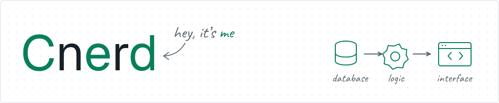

<picture>
  <source media="(prefers-color-scheme: dark)" srcset="assets/profile-header-color2-dark.svg">
  <source media="(prefers-color-scheme: light)" srcset="assets/profile-header-color2-light.svg">
  
</picture>

# Hey, I’m Mahadi

 **Full Stack AI Engineer** ·  Dhaka, Bangladesh

I like building things and thinking through problems from first principles. Mostly SaaS products, commerce tools, and AI apps.

AI agents help me plan, code, and test. I also build AI features with LLM APIs and RAG.

[ Portfolio](https://cnerdfolio.vercel.app/) &nbsp; [ LinkedIn](https://linkedin.com/in/cnerd-mahadi) &nbsp; [ Email](mailto:mahadidroid@gmail.com) &nbsp; [ Résumé](https://drive.google.com/file/d/17UZ7nnFuZ4eWBq0iiNUgvZDqXjGnnXIa/view?usp=sharing)

##  What I’m working on

At **Bevy Commerce**, I build Shopify apps from database to interface:

 Built an affiliate platform from the ground up. 
 Added subscription billing and improved accounting workflows. 
 Reworked recommendation jobs for safer retries and reruns. 
 Created a PDF generation system with customizable templates.

Previously at **AISEO.ai**, I helped move AI content tools to Next.js and built responsive React interfaces.

##  Projects

###  [LITOL](https://github.com/Cnerd-Mahadi/litol_app)

Built an AI study app used by **60+ students**, with notes, editable summaries, and quizzes. Used Gemini and RAG to ground quizzes in their own study material.

[ Live](https://litol.vercel.app/) · [ Source](https://github.com/Cnerd-Mahadi/litol_app)

###  [BeatRos](https://github.com/Cnerd-Mahadi/BeatRos)

Built a personal commerce app with saved carts, Stripe checkout, and inventory management. Added background tasks for releasing stock and sending order emails.

[ Live](https://beatros.vercel.app/) · [ Source](https://github.com/Cnerd-Mahadi/BeatRos)

##  Tools I use

**Web:** TypeScript · React · Next.js · Remix · Tailwind CSS 
**Backend:** Node.js · Express · Prisma · PostgreSQL · Redis 
**AI:** Gemini · Vercel AI SDK · pgvector · RAG 
**Delivery:** Docker · GitHub Actions · BullMQ · QStash

##  Let’s connect

Open to remote engineering roles. [Drop me a line](mailto:mahadidroid@gmail.com).
