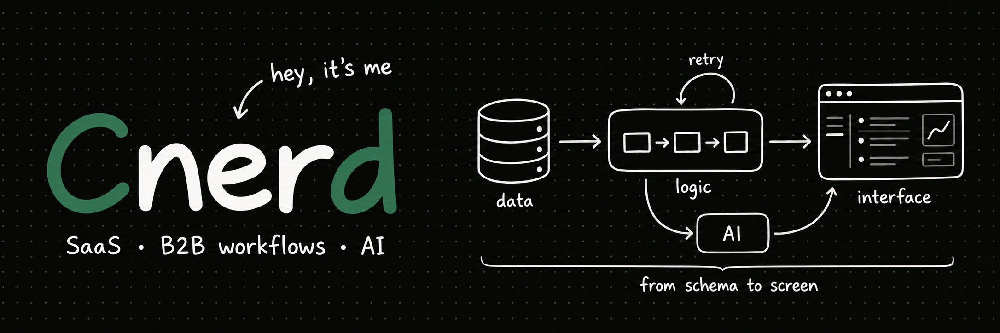
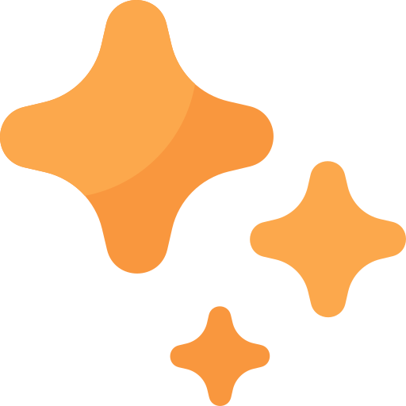

# Hey, I’m Mahadi

 **Full Stack AI Engineer** &nbsp;·&nbsp; &nbsp;Dhaka,&nbsp;Bangladesh

I like building things and thinking through problems from first principles. Mostly SaaS products, commerce tools, and AI apps.

AI agents help me plan, code, and test. I also build AI features with LLM APIs and RAG.

[<picture><source media="(prefers-color-scheme: dark)" srcset="assets/icons/uicons/link-portfolio-dark.svg"></picture>](https://cnerdfolio.vercel.app/) &nbsp; [<picture><source media="(prefers-color-scheme: dark)" srcset="assets/icons/uicons/link-linkedin-dark.svg"></picture>](https://linkedin.com/in/cnerd-mahadi) &nbsp; [<picture><source media="(prefers-color-scheme: dark)" srcset="assets/icons/uicons/link-email-dark.svg"></picture>](mailto:mahadidroid@gmail.com) &nbsp; [<picture><source media="(prefers-color-scheme: dark)" srcset="assets/icons/uicons/link-resume-dark.svg"></picture>](https://drive.google.com/file/d/17UZ7nnFuZ4eWBq0iiNUgvZDqXjGnnXIa/view?usp=sharing)

## What I’m working on

At **Bevy Commerce**, I build Shopify apps from database to interface:

 Built an **affiliate platform** from the ground up. 
 Added **subscription billing** and improved accounting workflows. 
 Reworked **recommendation jobs** for safer retries and reruns. 
 Created a **PDF generation system** with customizable templates.

Previously at **AISEO.ai**, I helped move AI content tools to Next.js and built responsive React interfaces.

## Projects

### LITOL

Built an AI study app used by **60+ students**, with notes, editable summaries, and quizzes. Used Gemini and RAG to ground quizzes in their own study material.

[<picture><source media="(prefers-color-scheme: dark)" srcset="assets/icons/uicons/link-live-dark.svg"></picture>](https://litol.vercel.app/) · [<picture><source media="(prefers-color-scheme: dark)" srcset="assets/icons/uicons/link-source-dark.svg"></picture>](https://github.com/Cnerd-Mahadi/litol_app)

### BeatRos

Built a personal commerce app with saved carts, Stripe checkout, and inventory management. Added background tasks for releasing stock and sending order emails.

[<picture><source media="(prefers-color-scheme: dark)" srcset="assets/icons/uicons/link-live-dark.svg"></picture>](https://beatros.vercel.app/) · [<picture><source media="(prefers-color-scheme: dark)" srcset="assets/icons/uicons/link-source-dark.svg"></picture>](https://github.com/Cnerd-Mahadi/BeatRos)

## Tools I use

**Web:** TypeScript · React · Next.js · Remix · Tailwind CSS 
**Backend:** Node.js · Express · Prisma · PostgreSQL · Redis 
**AI:** Gemini · Vercel AI SDK · pgvector · RAG 
**Delivery:** Docker · GitHub Actions · BullMQ · QStash

## Let’s connect

Open to remote engineering roles. [<picture><source media="(prefers-color-scheme: dark)" srcset="assets/icons/uicons/link-contact-dark.svg"></picture>](mailto:mahadidroid@gmail.com).

Icons by [Fathema Khanom](https://www.flaticon.com/authors/fathema-khanom), [justicon](https://www.flaticon.com/authors/justicon), [Magnific](https://www.flaticon.com/authors/magnific), [riajulislam](https://www.flaticon.com/authors/riajulislam), [sonnycandra](https://www.flaticon.com/authors/sonnycandra) and [Md Tanvirul Haque](https://www.flaticon.com/authors/md-tanvirul-haque) via Flaticon. [Asset sources](FLATICON-SOURCES.md).
